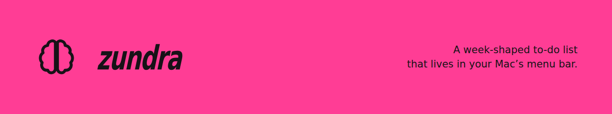

[](https://github.com/mh-coder-1918/zundra)

# Zundra

A menu-bar to-do app for macOS that plans your week and helps you work through it. Click the brain glyph in your menu bar, type a task, press **Return**. No Dock icon, no window, no account, no server, no network.

The name is from *zadania* — Polish for "tasks".

Everything lives in a JSON file in your own Application Support folder. Nothing leaves your Mac, because nothing in the app knows how to send it anywhere.

## Why another to-do app

Most of them are a flat list, which is fine until the list is forty items long and every one of them looks equally urgent. Zundra puts four ordinary ideas about getting things done into one small panel, and makes them cost one click each:

- **The week, not the day.** The list is split Monday→Sunday, so a task has a day rather than a vague someday. Anything that genuinely isn't for this week goes in a separate long-term bucket instead of rotting at the bottom.
- **The Eisenhower matrix, as one character.** Each task carries an optional `!` (do now), `↑` (schedule), `→` (delegate) or `·` (drop). Click to cycle it. The badge also *orders the day*, so triaging a list rearranges it.
- **Your own areas.** Type `#admin` at the start of a task and it becomes a coloured capsule instead of part of the text. Areas are your words, made by using them — no list to set up, none to maintain, and each one keeps a distinct colour for good.
- **Timeboxing.** Press ▶ on a task for a 20-minute focus box, or ✨ for a 60-minute box for something you've handed off and are waiting on. Several can run at once; the one finishing first shows next to the menu-bar icon.

Two spaces — **Personal** and **Work** — keep two weeks side by side, each with its own days, tallies and fold state, so an evening's list never gets crowded out by a work one.

## Features

- **Instant capture** — click the icon, type, press Return. The field clears and stays focused, so you can add several in a row.
- **Edit in place** — click a task's text and change it; edits save on Return or when you click away.
- **Drag to reorder or reschedule** — grab a task by its grip handle (`≡`) and drag it within a day, or onto another day's heading to move it there. Dragging across quadrants retags the row to match where you dropped it.
- **Done tallies** — each day heading shows what's left plus a green ✓ count of what you finished there this week. Click the tally to list those tasks, struck through, under the heading.
- **Delete, properly** — right-click a row and delete it. A task captured by mistake isn't *done*, and marking it done would inflate the tally you're meant to trust. Both delete and complete give you about four seconds to undo.
- **Collapsible days** — click a day heading to fold it shut; the choice is remembered per space.
- **Search** — press `⌘F` and the week is replaced by the matches. Space-separated terms all have to match, in any order, across the text and the `#area`.
- **"Plan the day"** — a distinct orange task appears once each morning at the top of today, in the **Work** space. Tick it, edit it or delete it and it stays gone until tomorrow.
- **Optional global shortcut** — right-click the icon to enable a system-wide `⌃⌥⌘T` that opens Zundra from any app. Off by default, and it needs no Accessibility permission.
- **Launch at login** — a checkbox in the footer.

## Requirements

- macOS 13 (Ventura) or later.
- Xcode **Command Line Tools** — `xcode-select --install`.

## Building it

There is no signed download yet. Building takes a few seconds:

```sh
git clone https://github.com/mh-coder-1918/zundra.git
cd zundra
./scripts/build-app.sh --install --run
```

That compiles the app, installs it to **/Applications/Zundra.app**, and launches it. The brain icon appears in your menu bar.

| Command | What it does |
|---|---|
| `./scripts/build-app.sh` | Build into `./build/Zundra.app` only |
| `./scripts/build-app.sh --install` | Also copy it to `/Applications` |
| `./scripts/build-app.sh --install --run` | Also (re)launch it |

The app is *ad-hoc signed* (`codesign -s -`), which needs no Apple Developer account and is enough to run on your own Mac. The build **fails** rather than continuing if signing fails — a broken signature is worse than no build, because macOS reports it as damaged rather than merely unverified.

There is no Xcode project. The app is compiled straight from `Sources/` by the script above, so there is deliberately nothing to open in an IDE.

## Using it

| Action | How |
|---|---|
| Open the panel | Single-click the menu-bar icon |
| Switch space | The **Personal / Work** picker at the top |
| Add a task | Type in the top field, press **Return** (lands on today) |
| Add to another day | Pick the day in the `Mon…Sun` picker first, then **Return** |
| Add to long-term | Press the purple **L** button beside the day picker |
| Tag an area | Start the text with `#name`, e.g. `#admin file the receipts` |
| Aim a quadrant | Press one of `! ↑ → ·` on the capture row (press again to clear) |
| Change a quadrant | Click the badge between the circle and the text to cycle it |
| Edit a task | Click its text, edit, press **Return** or click away |
| Reorder tasks | Drag the grip handle (`≡`) on the left up or down |
| Move to another day | Drag the grip handle onto that day's heading (or its `—` row) |
| Move space / bucket / area, or delete | **Right-click** the row |
| Complete a task | Click the circle to its left (then **Undo** within ~4s) |
| See what you finished | Click the green ✓ count on a day heading |
| Fold a day away | Click its heading |
| Find a task | `⌘F`, then type |
| Start a timer | Click ▶ at the right of the task (▶ becomes ■ to stop) |
| Time something you're waiting on | Click ✨ beside ▶ |
| Options menu | **Right-click** (or Control-click) the icon |
| Quit | Right-click the icon → **Quit Zundra**, or the **Quit** button in the footer |

### Keyboard shortcuts

| Shortcut | Action | Scope |
|---|---|---|
| `⌃⌥⌘T` | Open / close the panel | **Global** — works in any app, off by default |
| `⌘F` | Show / hide the search field | In the panel |
| `Return` | Add the typed task / save an edit | In the panel |
| `Esc` | Close the panel | In the panel |

## Your data

Everything lives in one folder, outside the repository and never committed:

```
~/Library/Application Support/Zundra/
  tasks.json        the open tasks (one flat array)
  areas.json        each area's colour, assigned once and kept
  completed.json    this week's per-day ✓ counts
  archive.json      a record of completed tasks, behind the ✓ tallies
  planning.json     when "Plan the day" was last seeded
```

If one of those files is ever unreadable, Zundra will **not** overwrite it. It moves the file aside under a dated name, starts without it, and says so in a strip at the top of the panel — so a corrupt byte costs you a restore, not your list.

To reset the app completely, quit it and delete that folder.

Timers are deliberately not persisted: quitting drops them all.

## Permissions and privacy

Zundra asks for nothing and connects to nothing. No accounts, no analytics, no crash reporting, no network calls of any kind. The global shortcut uses a Carbon hotkey, so even that needs no Accessibility permission.

## Contributing

Issues and pull requests are welcome. A fair amount of what looks accidental in this codebase is load-bearing — the ordering rules, the single flat array, the deferred re-sort — so it's worth asking before changing behaviour.

Deliberately out of scope, and not by accident: streaks, recurring tasks, rollover of unfinished days, filtering by area, and a matrix view.

## Licence

Apache-2.0. See [LICENSE](LICENSE).
